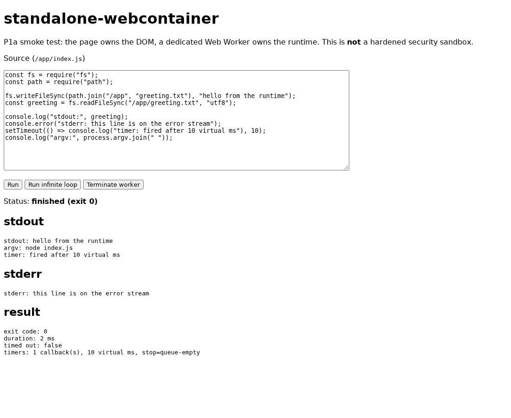

# P1a: the first browser build

Status: **implemented and verified, awaiting review.** Baseline `2c40703`, browser lane added on top.

The engine now runs in a browser. A page starts a dedicated Worker, the Worker constructs the *existing*
`InProcessRuntime` over the *existing* VFS, executes JavaScript through it, and returns real stdout, stderr and an exit
code to the page. No execution engine was substituted, and no runtime semantics were changed to make this pass: the diff
under `src/` is three new files in `src/browser/` and nothing else.



## What is where

| File | Role |
|---|---|
| `index.html` | The single page. Buttons, a textarea, three output panes. No framework. |
| `src/browser/protocol.ts` | The typed message contract, both directions. |
| `src/browser/runtime.worker.ts` | The only place a runtime is constructed in a browser. Owns VFS + runtime, answers `run`. |
| `src/browser/main.ts` | DOM, Worker lifecycle, request/response plumbing, rendering. |
| `vite.config.ts` | Build to `dist/browser`, Worker emitted as an ES module chunk. |
| `vitest.config.ts` | Pins the Node lane to `tests/unit`, so Playwright specs are not discovered by vitest. |
| `playwright.config.ts` | The browser lane, driving the Vite dev server. |
| `tests/browser/p1a.spec.ts` | Four browser tests. |

## Why a Worker, and what it is not

A synchronous `while (true) {}` cannot be interrupted from the thread it runs on. On the page it freezes the tab; in a
Worker it costs only that Worker, which the page can `terminate()`. That is the entire isolation story today.

**A Worker is a separate thread, not a security boundary.** Code in it can still consume CPU and memory, and any future
network capability would be just as real from there. This is not a hardened sandbox and must not be described as one.

## CSP: measured, not assumed

The loaders compile every module with `new Function` (`src/runtime/commonjs.ts`), so the runtime needs eval. Measured in
Chromium 156 against a dev-served page:

| Policy on the document | `new Function` in the page | `new Function` in our same-origin module Worker | `blob:` worker |
|---|---|---|---|
| `script-src 'self'` | blocked by CDP measurement, not a valid probe | **succeeded, run completed exit 0** | blocked |

The third column matters: it proves the policy was live. The second column is the surprise: a document-level `script-src`
did not stop our Worker from evaluating code. Two consequences, both stated as measurements rather than doctrine:

1. **Never rely on a document CSP to contain the runtime.** If a deployment needs that guarantee, it does not have it
   today. Containing user code is the worker-lane-plus-sandbox problem, not a header.
2. **Do not ship without `unsafe-eval`.** The documented, tested deployment policy is
   `script-src 'self' 'unsafe-eval'; worker-src 'self'` (asserted by the fourth browser test). Without `unsafe-eval`, a
   runtime that compiles strings will fail as soon as a module is executed.

Removing the eval dependency would mean a different loader design (an interpreter, or a WASM compilation step), which is
a charter-level decision, not a build flag.

## Verification

```
npm run typecheck        exit 0
npm test                 640 tests, 44 files, unchanged
npm run fixtures:check   20 definitions, 0 frozen, exit 0
npm run corpus:check     10 corpus packages, unchanged, 0 drifted
npm run build:browser    dist/browser: index.html 1.09 kB, page 3.29 kB, worker 208.39 kB (gzip 0.54/1.62/-)
npx playwright test      4 passed (2.1s)
```

Bundle audit: `grep` for `node:fs`, `node:path`, `harness/evidence`, `fixtures/definitions` in `dist/browser/assets/*.js`
returns nothing. The Worker chunk contains our loader (`native addons are not supported`, `MODULE_NOT_FOUND`,
`DecompressionStream`, acorn's `ecmaVersion`), so the code that runs is demonstrably ours.

## Known limitations

- One project, one file, no editor beyond a textarea, no persistence: reload discards everything.
- Output arrives when the run ends; nothing streams.
- A killed Worker's in-flight promise is dropped by design, so the page shows "worker terminated" rather than a result.
- `timeoutMs` bounds async gaps only. The infinite-loop case exists precisely to show what it cannot stop.
- The Node lane cannot see the browser lane. `npm run verify` stays browser-free and Playwright runs separately.
